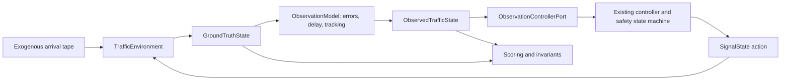

# Traffic Digital Twin Environment

RohAI теперь имеет отдельный closed-loop evaluation layer с несовершенным восприятием.
Исходные `Simulator`, `SimulationEngine` и быстрые unit/comparison tests сохранены.
Обучение controller, RL и новые нейросетевые архитектуры не добавлялись.

`GroundTruthState` и `ObservedTrafficState` — разные frozen Pydantic-модели.
Ground truth содержит latent identities, arrivals, queues, upstream backlog, downstream
occupancy, pedestrian crossings и фактические KPI. Эти поля не входят в policy input.
Observation содержит производственный `TrafficState` и диагностические measured tracks.
Контроллер получает только `observation.traffic`; не получает environment handle.

`ObservationControllerPort` проверяет тип во время исполнения и отвергает исходный
идеальный `TrafficState` со специальным evidence `source_camera_ids=("simulator",)`.
Отказ камеры обрабатывается существующим `ObservedTrafficController` и safety latch.
После первого подтверждённого observation потеря надёжности фиксирует all-red до нового
runtime — это текущее поведение RohAI, а не регуляторная рекомендация для дорог.

## Реализации TrafficEnvironment

| Реализация | Назначение |
|---|---|
| `FastTrafficEnvironment` | Adapter исходного point-queue simulator + ObservationModel |
| `DigitalTwinEnvironment` | Конечные полосы, downstream storage, повороты, pedestrian clearance, scenarios |
| `SumoTrafficEnvironment` | Boundary с внедряемым network-specific `SumoBridge`; проверен mocks |

Интерфейс: `now`, `step(SignalState) -> ObservedTrafficState`, `observe()`,
`ground_truth()` для scorer, `close()`. Reset выполняется созданием нового экземпляра
с декларативным сценарием, что также сбрасывает RNG, tracks и safety state.

Исходный `SimulationEngine` продолжает использовать идеальный snapshot для быстрых
unit-тестов. Его старый comparison endpoint не является production-perception evaluation.
Для оценки digital twin используются `ObservationControllerPort` и `twin_evaluation`.
API не является sandbox против намеренно написанного oracle-controller; разделение типов
и runner предотвращают случайную передачу truth штатным policy.

## Динамика

Demand заранее преобразуется в arrival tape, независимый от policy/service RNG.
Периоды задают неравномерный и меняющийся спрос, Poisson/regular/bursty arrivals.
Идентичный seed и сценарий дают одинаковый hash tape для fixed и adaptive.
Arrival означает предложенный сети спрос; admission на занятую полосу может произойти позже.
Отклонённые admission не исчезают: они остаются в upstream backlog и учитываются в delay.

Полосы имеют конечную длину в метрах. Car/bus/truck/motorcycle/bicycle занимают разное
место и имеют разные service headways. FIFO сохраняет head-of-line blocking.
Left/straight/right movements маршрутизируются к разным выходам. Конечная downstream
ёмкость, travel time и incidents блокируют discharge и создают spillback.

Vehicle service возможен только при соответствующем GREEN. На green onset действует
reaction delay. Left turns резервируют условную конфликтную область эксклюзивно;
straight/right lanes одной фазы могут обслуживаться параллельно. Короткий vehicle
clearance не разрешает конфликтующую фазу до освобождения области. Pedestrians получают
отдельную фазу и продолжают crossing после её окончания; новые vehicle departures
блокируются до clearance. Это модель конфликтов для evaluation, не точная геометрия дорог.

Время движется фиксированными ticks, по умолчанию 0,25 s. Arrivals внутри tick имеют
дробный вклад в wait integral; admission/service округляются к tick. `fps * step_s <= 1`
обязательно, чтобы не создавать несколько кадров из одного будущего состояния.
Changing step size — изменение модели эксперимента; побитовая идентичность между
разными step sizes не обещается. Lane changing и непрерывная car-following физика отсутствуют.

## SUMO boundary

В проверенном окружении нет `sumo` в PATH, `SUMO_HOME`, `traci` и `libsumo`; также не
найден бинарник в стандартных Windows Eclipse/Sumo paths. Реальная SUMO integration
не запускалась. Mock-тест проверяет порядок `apply_signal -> simulation_step -> read_truth`,
монотонность времени, применение того же observation model и закрытие bridge.

Будущая реализация `SumoBridge` должна содержать `.sumocfg`/network/route hashes,
seed, фиксированный step, mapping TLS links к фазам RohAI, lane/type/turn mapping,
счётчики arrivals/departures и pedestrian state. Именно bridge вызывает TraCI/libsumo.
Core controller не должен импортировать SUMO, знать TLS indices или получать его truth API.
До проверки на реальном executable статус остаётся `ADAPTER_BOUNDARY_ONLY_NOT_FIELD_VERIFIED`.
