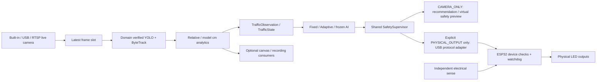

# Physical Maket Mode

Это отдельный локальный stand runtime, а не road deployment. Запуск:
`rohai maket start --config configs/maket/maket.json`; console `/maket`, port 8001.
Default output mode — CAMERA_ONLY: встроенная камера ноутбука является полноценным
live source. ESP32, USB/RTSP камеры и Serial dependency не нужны для vision demo.
VISION_READY, CONTROL_READY и HARDWARE_READY независимы; отсутствие ESP32 не является
общим FAIL. Mock, synthetic source и replay не подставляются вместо live frames.
Wizard проверяет camera indices 0–10; вне диапазона индекс задаётся явно.
BUILTIN_CAMERA/USB_CAMERA выбираются оператором, RTSP optional, VIDEO_FILE — Replay.
AUTO Serial применяется только в явно выбранном PHYSICAL_OUTPUT.

Default COCO_BASELINE использует текущие pinned YOLO weights и исходный UNSPECIFIED
manifest. Toy accuracy не измерена. Отдельный MAKET_MODEL требует PHYSICAL_MAKET
manifest и поддерживает verified package/ModelRegistry. Learned ACTIVE требует
MAKET_MODEL и measured release reports. Отсутствующие/повреждённые weights оставляют
camera-only commissioning preview; control блокируется.

`RuntimeMode` задаёт SIMULATION, VIDEO_REPLAY, PHYSICAL_MAKET, REAL_ROAD.
`mode_router.application_for` выбирает приложения; REAL_ROAD actuation запрещена.
Legacy simulation/replay API сохранён. Общий state contract — TrafficState;
learned bridge использует тот же ObservationV1/validity masks/action schema,
что simulator, без GroundTruthState и без подстановки model cm в road-meter features.
Fixed/Adaptive/learned requests проходят существующий SafetySupervisor.
Manual hardware test использует его core SafetyController, с authority OPERATOR:
не создаёт фиктивных camera observations и не является AI ACTIVE.

Capture/inference/analytics/preview имеют отдельные threads и latest slots capacity 1.
Overload выбрасывает старые frames. Control — monotonic configured cadence; Serial,
policy evaluation, alignment, JPEG и запись вынесены из event loop. Policy executor
один: timeout не освобождает ещё занятого worker для бесконечного запуска jobs.
При policy failure остаётся deterministic baseline, AI mode сбрасывается в SHADOW.
Короткие CPU операции сборки telemetry выполняются в loop; p50/p95 проверять на
целевом ноутбуке. Thread isolation не является sandbox для недоверенного native code.

SHADOW показывает/logs policy output, а hardware получает baseline/manual request.
В CAMERA_ONLY нет physical connection, STATUS/HELLO/ARM/SIGNAL/ESTOP или ACK:
recommendation и virtual safety preview журналируются с executed_action=null.
Stop/reconnect не отправляет команды устройству; ACTIVE и Hardware Test запрещены.
ACTIVE learned требует compatible frozen package, measured OFFLINE/SHADOW/STAND reports,
их SHA256 в approval и полного preflight плюс локальную кнопку ARM. Ни модель,
ни runtime не создают optimizer и не меняют веса. Approval files доверяются оператору
с правом записи; это не внешняя certification или подписанная identity infrastructure.

Здесь safe mode явно MAKET_ALL_RED; это requirement stand wiring, не рекомендация
traffic mode для дороги. Requested, supervisor-approved, command-sent, ACK phase,
electrical sense и отсутствие optical lamp proof показаны отдельно. HTTP 200 не
доказывает свет LED. Все физические claims требуют HIL и acceptance records.

## Using RohAI with only a laptop camera

1. `.venv/Scripts/python.exe -m traffic_vision.cli maket start --open`; CLI включает
   локальную HttpOnly session без копирования token. `/maket` — Simple Mode,
   `/maket/engineer` — прежние расширенные controls. См. [MAKET_SIMPLE_MODE.md](MAKET_SIMPLE_MODE.md).
2. Discover cameras проверяет 0–10. В Windows DSHOW и MSMF проверяются последовательно,
   после закрытия предыдущего процесса; каждый probe имеет 4 s deadline. При одном
   working source он только предлагается, при нескольких нужен выбор.
3. Preview/Test показывает index, реально полученный frame, resolution, reported FPS
   и backend. Friendly name/device path доступны через optional
   `cv2-enumerate-cameras`; без provider UI честно пишет name unavailable.
   Номер 0 не считается гарантированной встроенной камерой.
4. Выберите BUILTIN_CAMERA, CAMERA_ONLY, preset и Select + Save. Теперь основной
   canvas показывает непрерывный свежий live feed, не discovery snapshot.
5. Настройте crop → rotation → mirror. Detection, tracking, normalized geometry и
   reference image используют именно transformed frame. Любое изменение transform,
   source/backend или preset/resolution меняет camera identity и требует calibration.
   ROI задаётся как detection_zone в wizard после transforms.
6. Нарисуйте boundary, N/S/E/W incoming/lanes/queue zones, entry/stop/exit lines и
   pedestrian zones; подтвердите live pose и сохраните calibration. Требуются static
   reference features вне approach masks для проверки положения ноутбука.
7. Start Camera Only / Shadow включает adaptive/frozen AI recommendations и decision
   log без hardware. Record video optional; observation/decision session пишется
   автоматически с bounded retention. Необнаруженная toy car — ограничение baseline,
   а не основание создавать bbox или ground truth.
8. После отключения/движения камеры demo остановится. Restart camera, проверка live
   frame, Revalidate camera pose либо новая calibration, затем явный Start; AI сам
   не возобновляется. При другом resolution старая calibration не принимается.
9. Позже остановите demo, выберите PHYSICAL_OUTPUT, обнаруженный COM и сохраните.
   Camera/vision код тот же. Physical Start требует hardware preflight/local ARM;
   проводка, flashing и HIL acceptance остаются отдельными обязательными шагами.

LOW requests 640×480 / up to 5 inference Hz; BALANCED 1280×720 / up to 10 Hz;
HIGH requests 3840×2160 / up to 20 Hz. Driver may negotiate a lower resolution;
these are targets, not measured throughput guarantees. Control remains configured
independently (default 5 Hz). Dashboard exposes actual rates, latency and drops.
Local-camera native driver continuously writes a single shared latest-frame buffer
in an isolated process; open/read/lock waits are bounded and hung workers terminated.
Inference consumes the newest slot; raw live preview does not wait for YOLO startup.

CAMERA_PERMISSION_DENIED/CAMERA_IN_USE are reported when the driver exposes such an
error. OpenCV often returns only false from open/read: CAMERA_OPEN_FAILED/FRAME_TIMEOUT
then include Privacy, Teams/Zoom/browser and driver troubleshooting, without claiming
an exact cause. CAMERA_NOT_FOUND is the aggregate discovery result if no source works.
The [OpenCV VideoCapture API](https://docs.opencv.org/4.x/d8/dfe/classcv_1_1VideoCapture.html)
documents backend-specific open/read/property behavior; success requires an actual frame.
